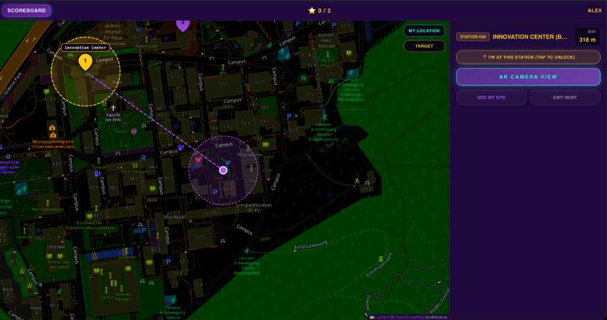
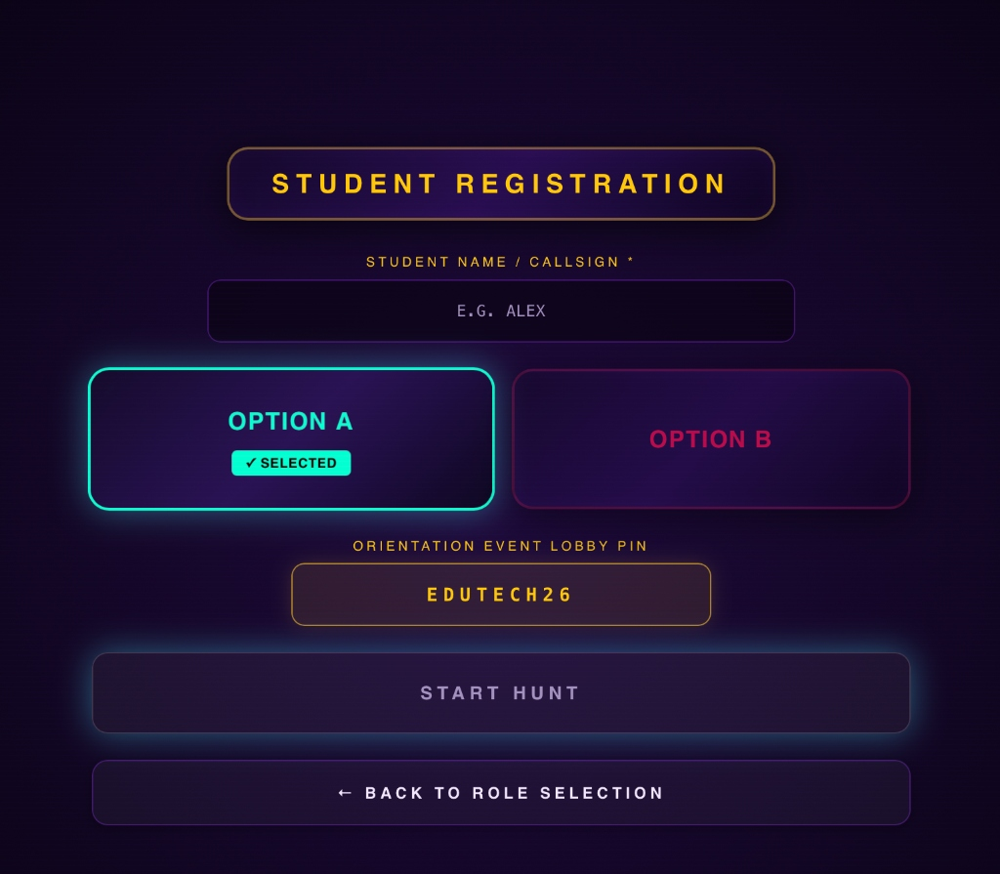

# Campus Orientation (GPS Scavenger Hunt)

A full-stack, location-based campus exploration and onboarding web platform built for the official M.Sc. Educational Technology Orientation Day at Saarland University (Universität des Saarlandes).

**Live Application:** [edutech-orientation-scavenger-hunt.vercel.app](https://edutech-orientation-scavenger-hunt.vercel.app)

---

## Overview

The platform replaces traditional passive campus walkthroughs with an interactive, GPS-guided exploration quest for incoming graduate students. Student teams navigate physical coordinates across the Saarbrücken campus, locate key academic and research facilities (including the Innovation Center, DFKI AI Research Center, and central university amenities), and complete checkpoint challenges.

---

## Screenshots

### Interactive Campus Map & Station Telemetry


### Student Registration & Track Selection


---

## Key Features

- **Real-Time Geolocation & Navigation:** Computes distance and bearings dynamically using the Haversine formula and compass orientation via the browser Geolocation API.
- **Geofenced Station Unlocking:** Automatically unlocks station tasks within a 65-meter proximity radius, with manual bypass options for GPS dead-zones.
- **QR Code Fast-Track:** Allows zero-friction onboarding through poster QR codes that automatically assign teams to designated tracks (`track=a` / `track=b`).
- **Live Telemetry & Instructor Dashboard:** Centralized monitor tracking team locations, completed stations, and photo verification in real time via Supabase.
- **Camera Integration:** In-browser media capture (MediaDevices API) for uploading photo proofs at physical checkpoints.

---

## Tech Stack

- **Frontend:** React 18, TanStack Start (SSR), TanStack Router, TanStack Query
- **Styling & UI:** Tailwind CSS, Radix UI primitives
- **Mapping:** Leaflet (OpenStreetMap)
- **Backend & Database:** Supabase (PostgreSQL), RESTful API endpoints
- **Media & Audio:** HTML5 MediaDevices API, Web Audio API

---

## Project Structure

```bash
edutech-orientation-scavenger-hunt/
├── src/
│   ├── api.js                # Centralized Axios client and API endpoints
│   ├── GameApp.jsx           # Core game container and session router
│   ├── components/           # Cockpit frame, radar display, option selectors
│   ├── pages/
│   │   ├── Home.jsx          # QR onboarding, route selection, and callsign entry
│   │   ├── StudentView.jsx   # Live student quest interface and photo upload
│   │   ├── AdminDashboard.jsx# Route creation and session configuration
│   │   ├── SessionMonitor.jsx# Live real-time instructor telemetry and photo feed
│   │   └── Presentation.jsx  # Stage presentation mode and live leaderboard
│   ├── routes/api/           # REST endpoints for teams, checkpoints, and completions
│   ├── utils.js              # Geolocation math and UdS campus presets
│   └── utils/audio.js        # Soundscapes and audio cue engine
├── screenshots/              # Application screenshots
├── package.json
└── vite.config.ts
```

---

## Local Development

1. **Clone the repository:**
   ```bash
   git clone https://github.com/osmnmelih/edutech-orientation-scavenger-hunt.git
   cd edutech-orientation-scavenger-hunt
   ```

2. **Install dependencies:**
   ```bash
   npm install
   ```

3. **Configure environment variables:**
   Create a `.env` file in the root directory:
   ```env
   VITE_SUPABASE_URL=your_supabase_project_url
   VITE_SUPABASE_ANON_KEY=your_supabase_anon_key
   ```

4. **Run the development server:**
   ```bash
   npm run dev
   ```

---

## Academic Context

- **Institution:** Universität des Saarlandes (Saarbrücken, Germany)
- **Program:** M.Sc. in Educational Technology
- **Occasion:** Official Orientation Day (Winter Semester 2026/27)
- **Developer:** [Osman Melih Cabik](https://osmnmelih.github.io)

---

## License

This project is licensed under the MIT License.
